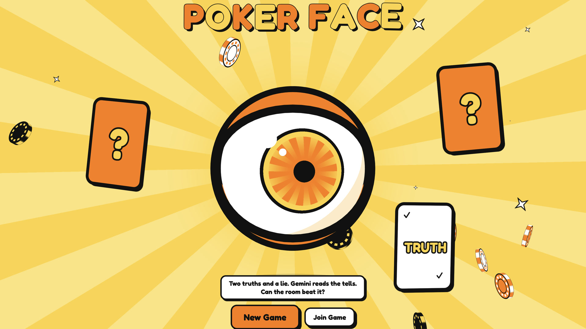
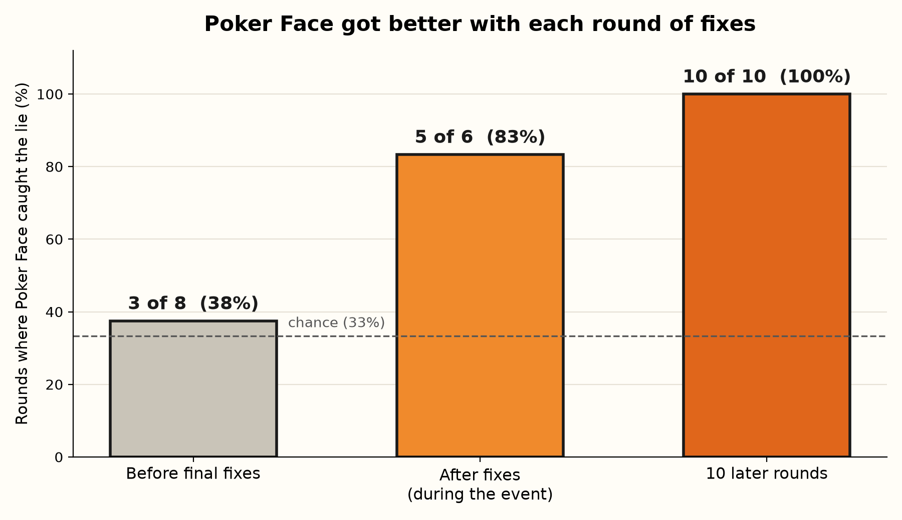

# Poker Face

Two truths and a lie, played live against Gemini. A player says three statements on camera, everyone in the room votes on their phones, and Gemini reads the tells and calls the lie with a confidence score.

Built in one day at the [Gemini 4 NYC Hackathon](https://cerebralvalley.ai/e/gemini-4-nyc) (Cerebral Valley and Google DeepMind, Nov 21, 2026) by Samer Shaban and Belal Ezat.



> Poker Face is a game opponent reading in-the-moment behavior. It is not a lie detector, and it scores the moment, never the person.

## How a round works

1. **Join.** The stage shows a QR code; phones scan it to join the room and vote.
2. **Baseline.** The player answers two easy questions truthfully, so every later signal is compared with how *this* person normally talks and looks.
3. **Statements.** The player says three statements and picks which one is the lie.
4. **Analyze.** The server measures each clip against the baseline and asks Gemini Decision 1 which statement is the lie.
5. **Follow-up.** Under 70% confidence, Gemini 4 Neon rewatches the clip and asks a tailored follow-up question (up to 3).
6. **Call.** Gemini names the lie with its confidence and the strongest timestamped cue, and the stage stamps BUSTED on that frame.
7. **Reveal.** The player names the real lie; the scoreboard shows Gemini vs. the Room.

## How the call is made

| Signal | Where it comes from |
| --- | --- |
| Blinks, gaze breaks | Google MediaPipe Face Landmarker, every frame, blink cutoff set per clip |
| Pauses, filler words, restarts, speech rate | Word-level timestamps from transcription |
| Pitch rises, hedging, put-on nervousness, believability | Gemini Decision 1 questions on the raw audio and video |
| Second opinion on hard rounds | Gemini 4 Neon (25% weight after a follow-up) |

All measured signals are sent as differences from the player's baseline, together with the clips, in one fused Decision 1 call. Things we changed after watching real rounds:

- **Order bias.** Reordering the same three clips once flipped the answer, so Decision 1 runs in both orders (1-2-3 and 3-2-1) in parallel and the results are averaged.
- **What is said, not just how.** "I met Batman" slipped through when only delivery was judged, so a believability question was added.
- **Bad timer.** Response delay was dropped from the decision: it started at the operator's tap, not when the player spoke.
- **Chatter.** "Are you ready?" at the start of a clip is trimmed with a careful rule; a filler-only opening ("um, uh...") is kept, because that hesitation is a tell.
- **Latency budget.** Neon's agentic video mode took 17 to 22 s on two 5-second clips vs 6 s static with the same answer, so live rounds use static mode with a 12 s cutoff and a template fallback question.

## Getting better each round

Every round is saved with the true answer. After each change, `eval/run_eval.py` replays every saved round against baselines (random guess, the room's vote, a single plain Gemini call) and a modality ablation (transcript only, audio only, video only, everything combined), so we could see whether a fix actually helped. Live calls went 3 for 8 before our final fixes and 5 for the next 6 during the event. In 10 more rounds played afterward, it caught the lie all 10 times.



## Stack

- **Server:** Python 3.11, FastAPI, SQLite, ffmpeg, MediaPipe, `google-genai`
- **Models:** Gemini Decision 1 (Decisions API), Gemini 4 Neon, Gemini transcription with word timestamps
- **Web:** Vite, React, TypeScript, Babylon.js (Ogle, the Eye, an original mascot drawn in code), WebSocket room, QR join
- **Network:** Cloudflare tunnel so phones can reach the laptop over HTTPS (needed for the camera)

## Run it

Requires Python 3.11, Node 18+, ffmpeg, and a Gemini API key with Decisions API access.

```sh
# Server (from the repo root)
python3.11 -m venv .venv
.venv/bin/pip install -r server/requirements.txt
cp .env.example .env            # add GEMINI_API_KEY
.venv/bin/uvicorn server.main:app --reload --host 0.0.0.0 --port 8000

# Web (second terminal)
cd web && npm install
npm run dev:brain               # stage at /stage, phones at /play

# Phones (third terminal)
cloudflared tunnel --url http://localhost:5173   # open /stage through this link
```

Eval: `.venv/bin/pip install -r eval/requirements.txt && .venv/bin/python -m eval.run_eval`

## Layout

```
server/   FastAPI app, clip measures, Decision 1 and Neon calls, scoring, room WebSocket
web/      Stage, phone, and start pages (see web/README.md)
eval/     Replay harness, baselines, modality ablation, calibration, charts
docs/     Screenshots and Decision 1 timing data
```

The original plan is in `Poker Face Room Edition PRD.md`; the shipped version differs where real rounds taught us something (see the list above).

## Team

- **Samer Shaban:** stage and phone app, game UI
- **Belal Ezat:** server and Gemini pipeline, measurement layer, eval harness, start page
